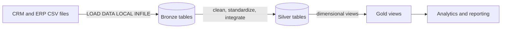

# SQL Data Warehouse

A MySQL 8.4 analytics warehouse that consolidates CRM and ERP CSV exports into a
three-layer Medallion architecture:

- **Bronze** stores source-shaped raw data.
- **Silver** cleans, standardizes, and integrates the source data.
- **Gold** exposes dimensional views for reporting and analysis.

## Architecture at a glance



The detailed architecture, table catalog, column descriptions, lineage, and
transformation rules are in [docs/architecture.md](docs/architecture.md).

## Repository layout

```text
datasets/                 Source CSV files
docs/architecture.md      Architecture, lineage, and schema reference
scripts/init_database.sql Creates warehouse and layer schemas
scripts/bronze/           Raw table definitions and CSV loading
scripts/silver/           Clean table definitions and transformation procedure
scripts/gold/             Analytics views
scripts/docker/           Local Docker startup and pipeline runner
tests/                    Test area (no automated tests yet)
```

## Data sources

The `datasets/` directory contains six source CSVs:

| File | Source | Bronze target |
| --- | --- | --- |
| `cust_info.csv` | CRM customer attributes | `bronze.cmr_cust_info` |
| `prd_info.csv` | CRM product attributes | `bronze.cmr_prd_info` |
| `sales_details.csv` | CRM sales transactions | `bronze.cmr_sales_details` |
| `CUST_AZ12.csv` | ERP customer demographics | `bronze.erp_cust_az12` |
| `LOC_A101.csv` | ERP customer locations | `bronze.erp_loc_a101` |
| `PX_CAT_G1V2.csv` | ERP product categories | `bronze.erp_px_cat_g1v2` |

## Run locally with Docker

### Requirements

- Docker Desktop or Docker Engine running locally.
- The six CSV files above present in `datasets/`.
- A host port for MySQL (`3306` by default).

From the repository root, make the launcher executable once and run it:

```bash
chmod +x scripts/docker/start_warehouse.sh
./scripts/docker/start_warehouse.sh
```

The launcher prompts for a MySQL root password without echoing it. Alternatively,
provide the password through the environment:

```bash
MYSQL_ROOT_PASSWORD='your-local-password' ./scripts/docker/start_warehouse.sh
```

Use a different host port if `3306` is already occupied. Keep the same value on
subsequent runs for the existing container:

```bash
MYSQL_PORT=3307 ./scripts/docker/start_warehouse.sh
mysql -h 127.0.0.1 -P 3307 -u root -p
```

The launcher uses the `mysql:8.4` image, publishes MySQL only on localhost,
mounts `datasets/` read-only at `/datasets`, and stores MySQL files in the named
Docker volume `sql-data-warehouse-mysql-data`. The default container and volume
names can be changed with `MYSQL_CONTAINER_NAME` and `MYSQL_VOLUME_NAME`.

### What the launcher runs

In order, the launcher:

1. Creates and starts the MySQL container and waits for the server.
2. Creates the warehouse and layer schemas.
3. Creates Bronze and Silver tables.
4. Truncates and reloads Bronze from the mounted CSV files.
5. Creates and calls `silver.load_silver_layer()` to refresh Silver.
6. Creates or replaces the Gold views.

**Every run refreshes Bronze and Silver:** the loaders truncate their target
tables before inserting data. The named Docker volume persists database files
when the container is stopped or restarted; it is not a backup. Removing the
volume deletes the stored database data.

To stop the container while retaining the database volume:

```bash
docker stop sql-data-warehouse-mysql
```

To start it again:

```bash
docker start sql-data-warehouse-mysql
```

To connect:

```bash
mysql -h 127.0.0.1 -P 3306 -u root -p
```

The container has `LOAD DATA LOCAL INFILE` enabled for this workflow. If you run
the SQL manually with a MySQL client, enable local file loading in the client
and make the CSV files available at the paths used in
[`proc_load_bronze.sql`](scripts/bronze/proc_load_bronze.sql).

## Query the Gold layer

Gold objects are views, so query them like tables:

```sql
SELECT *
FROM gold.fact_sales
LIMIT 10;
```

Available views:

- `gold.dim_customers` — customer reporting attributes.
- `gold.dim_products` — current product records enriched with ERP category data.
- `gold.fact_sales` — sales rows joined to customer and product dimension keys.

## SQL execution order

When running outside the Docker launcher, apply the scripts in this order:

1. [`scripts/init_database.sql`](scripts/init_database.sql)
2. [`scripts/bronze/ddl_bronze.sql`](scripts/bronze/ddl_bronze.sql)
3. [`scripts/silver/ddl_silver.sql`](scripts/silver/ddl_silver.sql)
4. [`scripts/bronze/proc_load_bronze.sql`](scripts/bronze/proc_load_bronze.sql)
5. [`scripts/silver/proc_load_silver.sql`](scripts/silver/proc_load_silver.sql), then call `CALL silver.load_silver_layer();`
6. [`scripts/gold/ddl_gold.sql`](scripts/gold/ddl_gold.sql)

See [docs/architecture.md](docs/architecture.md) for the full schema and
transformation reference.

## Current limitations

- `warehouse_db` is created by the initializer, while the layer objects are
  created in the separate `bronze`, `silver`, and `gold` schemas/databases.
- There are no automated SQL tests in the repository yet.
- Gold dimension keys are generated with `ROW_NUMBER()` in views; they are
  query-time keys and can change when the underlying rows or sort order change.
