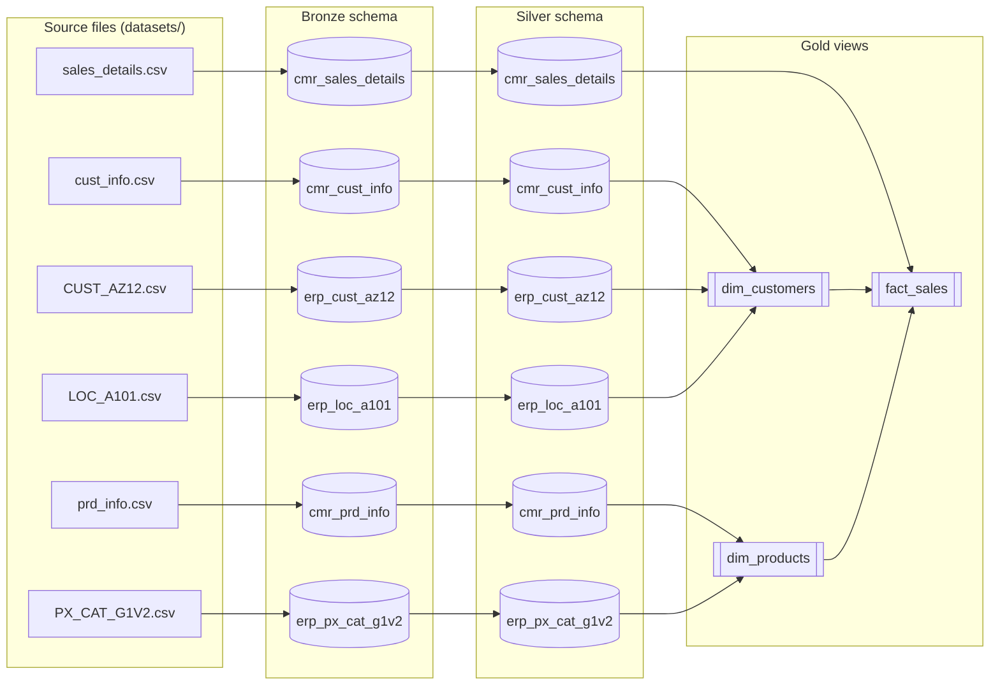
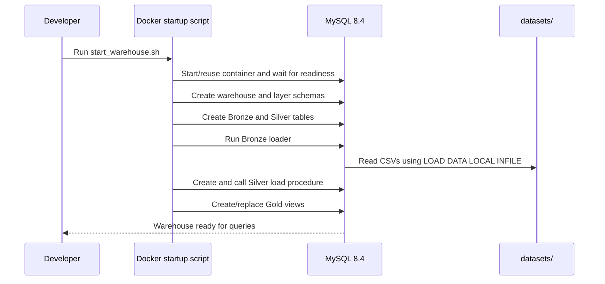

# Data Warehouse Architecture and Data Dictionary

This document describes the MySQL schemas, tables, transformations, and Gold
views implemented by the SQL files in this repository. Object names and column
types below follow the current scripts.

## Architecture

The warehouse follows a Medallion-style pipeline. Source CRM and ERP CSV files
are loaded into raw Bronze tables, transformed into standardized Silver tables,
and presented to analytics users through Gold dimensional views.

### Data flow and orchestration

The Docker launcher applies SQL in dependency order:

1. `scripts/init_database.sql`
2. `scripts/bronze/ddl_bronze.sql`
3. `scripts/silver/ddl_silver.sql`
4. `scripts/bronze/proc_load_bronze.sql`
5. `scripts/silver/proc_load_silver.sql`
6. `CALL silver.load_silver_layer();`
7. `scripts/gold/ddl_gold.sql`

The Bronze loader script and Silver load procedure truncate their target
tables before inserting rows. Each launcher run therefore performs a full
refresh of those layers; it is not an incremental load. Gold views are replaced
from the latest Silver data.

## Schemas and database names

The initializer creates `warehouse_db` and selects it, then creates three
additional MySQL schemas (which MySQL treats as databases): `bronze`, `silver`,
and `gold`. All layer tables, procedures, and views are qualified with their
layer schema names. The current scripts do not place layer objects inside
`warehouse_db`.

## Source-file lineage

| CSV file | Source domain | Bronze target |
| --- | --- | --- |
| `datasets/cust_info.csv` | CRM customer profile | `bronze.cmr_cust_info` |
| `datasets/prd_info.csv` | CRM product catalog | `bronze.cmr_prd_info` |
| `datasets/sales_details.csv` | CRM sales transactions | `bronze.cmr_sales_details` |
| `datasets/CUST_AZ12.csv` | ERP customer demographics | `bronze.erp_cust_az12` |
| `datasets/LOC_A101.csv` | ERP customer location | `bronze.erp_loc_a101` |
| `datasets/PX_CAT_G1V2.csv` | ERP product category | `bronze.erp_px_cat_g1v2` |

## Bronze layer: source-shaped landing tables

Bronze tables preserve the source fields and use nullable columns without
declared primary or foreign keys. Numeric empty strings are converted to NULL
by the loader where applicable. Text is mostly passed through as landed.

### `bronze.cmr_cust_info`

Loaded from `cust_info.csv`.

| Column | Type | Description |
| --- | --- | --- |
| `cst_id` | `INT` | CRM customer identifier. |
| `cst_key` | `VARCHAR(50)` | CRM customer business key used to align source systems. |
| `cst_firstname` | `VARCHAR(50)` | Customer first name. |
| `cst_lastname` | `VARCHAR(50)` | Customer last name. |
| `cst_marital_status` | `VARCHAR(5)` | Source marital-status code. |
| `cst_gndr` | `VARCHAR(5)` | Source gender code. |
| `cst_create_data` | `DATE` | Customer creation date; source column is `cst_create_date`. |

### `bronze.cmr_prd_info`

Loaded from `prd_info.csv`.

| Column | Type | Description |
| --- | --- | --- |
| `prd_id` | `INT` | CRM product identifier. |
| `prd_key` | `VARCHAR(50)` | CRM product business key, including its category prefix. |
| `prd_nm` | `VARCHAR(50)` | Product name. |
| `prd_cost` | `INT` | Product cost; empty input is loaded as NULL. |
| `prd_line` | `VARCHAR(5)` | Source product-line code. |
| `prd_start_dt` | `DATETIME` | Product-record effective start date/time. |
| `prd_end_dt` | `DATETIME` | Source end date/time; empty input is NULL. |

### `bronze.cmr_sales_details`

Loaded from `sales_details.csv`. Dates are landed as integer-formatted
`YYYYMMDD` values for Silver conversion.

| Column | Type | Description |
| --- | --- | --- |
| `sls_ord_num` | `VARCHAR(50)` | Order number. |
| `sls_prd_key` | `VARCHAR(50)` | Product business key referenced by the transaction. |
| `sls_cust_id` | `INT` | CRM customer identifier. |
| `sls_order_dt` | `INT` | Order date in `YYYYMMDD` form. |
| `sls_ship_dt` | `INT` | Ship date in `YYYYMMDD` form. |
| `sls_due_dt` | `INT` | Due date in `YYYYMMDD` form. |
| `sls_sales` | `INT` | Source sales amount. |
| `sls_quantity` | `INT` | Quantity sold. |
| `sls_price` | `INT` | Source unit price. |

### `bronze.erp_cust_az12`

Loaded from `CUST_AZ12.csv`.

| Column | Type | Description |
| --- | --- | --- |
| `cid` | `VARCHAR(50)` | ERP customer identifier; may have a `NAS` prefix. |
| `bdate` | `DATE` | Customer birth date. |
| `gen` | `VARCHAR(10)` | Source gender label or code. |

### `bronze.erp_loc_a101`

Loaded from `LOC_A101.csv`.

| Column | Type | Description |
| --- | --- | --- |
| `cid` | `VARCHAR(50)` | ERP customer identifier; may contain hyphens. |
| `cntry` | `VARCHAR(50)` | Country name or source country code. |

### `bronze.erp_px_cat_g1v2`

Loaded from `PX_CAT_G1V2.csv`.

| Column | Type | Description |
| --- | --- | --- |
| `id` | `VARCHAR(50)` | ERP product category identifier. |
| `cat` | `VARCHAR(50)` | Category name. |
| `subcat` | `VARCHAR(50)` | Subcategory name. |
| `maintenance` | `VARCHAR(50)` | Source maintenance indicator. |

## Silver layer: cleaned and conformed tables

Silver tables have the same subject areas as Bronze, with standardized
attributes and a `dwh_created_date` load timestamp. The loader truncates and
repopulates each target on each run. No primary or foreign key constraints are
declared in the current DDL.

### `silver.cmr_cust_info`

| Column | Type | Description |
| --- | --- | --- |
| `cst_id` | `INT` | CRM customer identifier; duplicate IDs are reduced to the latest source creation date. |
| `cst_key` | `VARCHAR(50)` | CRM customer business key. |
| `cst_firstname` | `VARCHAR(50)` | Trimmed first name. |
| `cst_lastname` | `VARCHAR(50)` | Trimmed last name. |
| `cst_marital_status` | `VARCHAR(50)` | Standardized to `Single`, `Married`, or `n/a`. |
| `cst_gndr` | `VARCHAR(50)` | Standardized to `Male`, `Female`, or `n/a`. |
| `cst_create_data` | `DATE` | Customer creation date; the source field is named `cst_create_date`. |
| `dwh_created_date` | `DATETIME` | Defaults to the table insertion timestamp. |

### `silver.cmr_prd_info`

| Column | Type | Description |
| --- | --- | --- |
| `prd_id` | `INT` | CRM product identifier. |
| `cat_id` | `VARCHAR(50)` | Category key derived from the product key prefix, with `-` changed to `_`. |
| `prd_key` | `VARCHAR(50)` | Product business key with the category prefix removed. |
| `prd_nm` | `VARCHAR(50)` | Product name. |
| `prd_cost` | `INT` | Product cost; NULL is replaced with zero. |
| `prd_line` | `VARCHAR(50)` | Product line standardized to `Mountain`, `Road`, `Other Sales`, `Touring`, or `n/a`. |
| `prd_start_dt` | `DATE` | Product-record effective start date. |
| `prd_end_dt` | `DATE` | Derived as one day before the next start date within the source product key; the final version remains NULL. |
| `dwh_created_date` | `DATETIME` | Defaults to the table insertion timestamp. |

### `silver.cmr_sales_details`

| Column | Type | Description |
| --- | --- | --- |
| `sls_ord_num` | `VARCHAR(50)` | Order number. |
| `sls_prd_key` | `VARCHAR(50)` | Product business key used to link the product dimension. |
| `sls_cust_id` | `INT` | CRM customer identifier used to link the customer dimension. |
| `sls_order_dt` | `DATE` | Parsed from an eight-digit `YYYYMMDD` value; invalid-length, zero, or NULL values become NULL. |
| `sls_ship_dt` | `DATE` | Parsed from an eight-digit `YYYYMMDD` value; invalid-length, zero, or NULL values become NULL. |
| `sls_due_dt` | `DATE` | Parsed from an eight-digit `YYYYMMDD` value; invalid-length, zero, or NULL values become NULL. |
| `sls_sales` | `DECIMAL(12,2)` | Recalculated as quantity times normalized unit price; NULL when quantity is invalid or price cannot be derived. |
| `sls_quantity` | `INT` | Source quantity. |
| `sls_price` | `DECIMAL(12,2)` | Absolute source price when nonzero; otherwise derived from positive sales divided by positive quantity. |
| `dwh_created_date` | `DATETIME` | Defaults to the table insertion timestamp. |

### `silver.erp_cust_az12`

| Column | Type | Description |
| --- | --- | --- |
| `cid` | `VARCHAR(50)` | ERP customer key with a leading `NAS` prefix removed when present. |
| `bdate` | `DATE` | Birth date; future dates become NULL. |
| `gen` | `VARCHAR(50)` | Gender standardized to `Female`, `Male`, or `n/a`. |
| `dwh_created_date` | `DATETIME` | Defaults to the table insertion timestamp. |

### `silver.erp_loc_a101`

| Column | Type | Description |
| --- | --- | --- |
| `cid` | `VARCHAR(50)` | ERP customer key with hyphens removed. |
| `cntry` | `VARCHAR(50)` | `DE` maps to `Germany`, `US`/`USA` to `United States`; blank values map to `n/a`; other values are trimmed. |
| `dwh_created_date` | `DATETIME` | Defaults to the table insertion timestamp. |

### `silver.erp_px_cat_g1v2`

| Column | Type | Description |
| --- | --- | --- |
| `id` | `VARCHAR(50)` | ERP product category identifier. |
| `cat` | `VARCHAR(50)` | Category name copied from Bronze. |
| `subcat` | `VARCHAR(50)` | Subcategory name copied from Bronze. |
| `maintenance` | `VARCHAR(50)` | Maintenance indicator copied from Bronze. |
| `dwh_created_date` | `DATETIME` | Defaults to the table insertion timestamp. |

## Silver transformation summary

| Subject | Implemented transformation |
| --- | --- |
| CRM customers | Drops rows without `cst_id`, keeps the latest row for each ID by creation date, trims names, and standardizes marital-status and gender codes. |
| CRM products | Splits category prefix from product key, fills missing cost with zero, standardizes product-line codes, and derives end dates with `LEAD()`. |
| CRM sales | Converts `YYYYMMDD` integers to dates; uses absolute nonzero price or derives price from positive sales/quantity; calculates sales from normalized price and quantity. |
| ERP customers | Removes `NAS` customer-key prefix, nulls future birth dates, and standardizes gender labels. |
| ERP locations | Removes key hyphens and standardizes selected country codes/names. |
| ERP categories | Copies category attributes into Silver without additional transformation. |

## Gold layer: analytics views

Gold objects are views defined in `scripts/gold/ddl_gold.sql`. They are not
persisted tables. They join Silver subject areas and expose reporting-friendly
column names.

### `gold.dim_customers`

**Intended grain:** one row per CRM customer record (`cst_id`) after Silver
deduplication.

| Output column | Source / expression | Description |
| --- | --- | --- |
| `customer_key` | `ROW_NUMBER() OVER (ORDER BY ci.cst_id)` | Query-time customer dimension key. |
| `customer_id` | `silver.cmr_cust_info.cst_id` | CRM customer identifier. |
| `customer_number` | `silver.cmr_cust_info.cst_key` | CRM customer business key. |
| `first_name` | `silver.cmr_cust_info.cst_firstname` | Customer first name. |
| `last_name` | `silver.cmr_cust_info.cst_lastname` | Customer last name. |
| `country` | `silver.erp_loc_a101.cntry` | Standardized country, when a location matches. |
| `marital_status` | `silver.cmr_cust_info.cst_marital_status` | Standardized CRM marital status. |
| `gender` | CRM gender unless `n/a`, otherwise ERP gender | CRM is preferred; ERP is the fallback. |
| `birthdate` | `silver.erp_cust_az12.bdate` | ERP birth date, when a customer matches. |
| `create_date` | `silver.cmr_cust_info.cst_create_data` | CRM creation date. |

Joins use CRM `cst_key` against standardized ERP `cid` in customer demographics
and location tables.

### `gold.dim_products`

**Intended grain:** one row per current product version, where current means
`prd_end_dt IS NULL`.

| Output column | Source / expression | Description |
| --- | --- | --- |
| `product_key` | `ROW_NUMBER() OVER (ORDER BY prd_start_dt, prd_key)` | Query-time product dimension key. |
| `product_id` | `silver.cmr_prd_info.prd_id` | CRM product identifier. |
| `product_number` | `silver.cmr_prd_info.prd_key` | Product business key without category prefix. |
| `product_name` | `silver.cmr_prd_info.prd_nm` | Product name. |
| `category_id` | `silver.cmr_prd_info.cat_id` | Derived category key. |
| `category` | `silver.erp_px_cat_g1v2.cat` | ERP category label, if matched. |
| `subcategory` | `silver.erp_px_cat_g1v2.subcat` | ERP subcategory label, if matched. |
| `maintenance` | `silver.erp_px_cat_g1v2.maintenance` | ERP maintenance indicator, if matched. |
| `cost` | `silver.cmr_prd_info.prd_cost` | Product cost. |
| `product_line` | `silver.cmr_prd_info.prd_line` | Standardized product-line label. |
| `start_date` | `silver.cmr_prd_info.prd_start_dt` | Effective start date. |
| `prd_end_dt` | `silver.cmr_prd_info.prd_end_dt` | End date; current rows are NULL. |

The category join compares `silver.cmr_prd_info.cat_id` to
`silver.erp_px_cat_g1v2.id`.

### `gold.fact_sales`

**Intended grain:** one row per Silver sales-detail row. The view preserves
transactions even when the customer or product dimension lookup does not match,
because both dimension joins are left joins.

| Output column | Source / expression | Description |
| --- | --- | --- |
| `order_number` | `silver.cmr_sales_details.sls_ord_num` | Order number. |
| `product_key` | `gold.dim_products.product_key` | Matched product dimension key; NULL if unmatched. |
| `customer_key` | `gold.dim_customers.customer_key` | Matched customer dimension key; NULL if unmatched. |
| `order_date` | `silver.cmr_sales_details.sls_order_dt` | Parsed order date. |
| `ship_date` | `silver.cmr_sales_details.sls_ship_dt` | Parsed ship date. |
| `due_date` | `silver.cmr_sales_details.sls_due_dt` | Parsed due date. |
| `sales_amount` | `silver.cmr_sales_details.sls_sales` | Normalized sales amount. |
| `quantity` | `silver.cmr_sales_details.sls_quantity` | Quantity sold. |
| `price` | `silver.cmr_sales_details.sls_price` | Normalized unit price. |

The view joins on sales `sls_prd_key = dim_products.product_number` and sales
`sls_cust_id = dim_customers.customer_id`.

## Operational notes and constraints

- The Docker launcher uses MySQL 8.4, a named persistent data volume, and a
  read-only mount of `datasets/` at `/datasets`. Bronze loads use
  `LOAD DATA LOCAL INFILE`; the launcher enables local infile for both client
  and server.
- To run the Bronze load manually, make the files available at `/datasets` or
  update the paths in `scripts/bronze/proc_load_bronze.sql`, and enable local
  infile in the MySQL client and server.
- The default host port is `3306`; use `MYSQL_PORT` to select another port if
  necessary. The launcher publishes MySQL only on `127.0.0.1`.
- `MYSQL_ROOT_PASSWORD` is prompted for if not supplied. On an existing
  container, the password must match the one used when that container was first
  initialized.
- The volume preserves database files between restarts, but the ETL scripts
  truncate and reload Bronze and Silver on every pipeline run.
- `customer_key` and `product_key` are generated by `ROW_NUMBER()` in views.
  They are not persisted surrogate keys and may be reassigned when row ordering
  changes.
- No primary keys, foreign keys, SQL test suite, or automated pipeline
  validation are currently defined in the repository.
- `warehouse_db` is created by the initializer, but current layer objects are
  created under the separate `bronze`, `silver`, and `gold` schemas.
